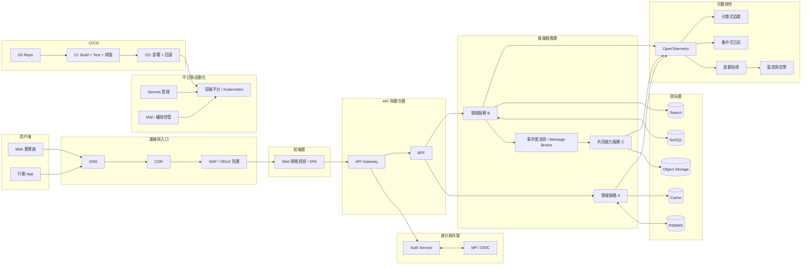

# System Architecture Specification

## Current architecture and document purpose

For the implemented architecture, read [the repository overview](../../../docs/architecture.md)
and [system context](../CONTEXT.md). The active system has two React/Vite SPAs,
`admin-ui` and `pos-ui`, sharing one Express/Prisma/PostgreSQL modular monolith.
The Windows loopback label agent is a separate workstation component, not a
cloud inventory service. POS is already implemented; no new POS system is planned
by this document.

Requirements/acceptance remain in [#31](https://github.com/skydreamer0/startup/issues/31)
and [#37](https://github.com/skydreamer0/startup/issues/37). Accepted [ADRs](adr/),
[API contracts](api/api_spec.md), Prisma schema/migrations and [standards](standards/)
each govern their own subject. [ROADMAP](../ROADMAP.md#current-status) links the
current implementation/evidence snapshot. This file is an index and historical
reference, not a second authority over those sources.

## Historical blueprint

The sections below preserve the earlier generic enterprise design. They do not
assert that every pictured service exists or authorize new dependencies, security
changes or deployment. In particular, API/BFF microservices, IdP/OIDC, Kubernetes,
message brokers, NoSQL, cache/search and OpenTelemetry are not the verified
runtime topology. The old blanket snake_case rule is not an instruction to rename
current Prisma/API fields; follow the actual contract and naming standards.
Historical links are reference documents, not acceptance evidence.

### Original purpose
Define the system architecture, dependencies, API standards, and infrastructure for the enterprise platform. This was the original blueprint's purpose, not current deployment authority.

## 2. Historical engineering assumptions
1. **Implementation Order**: DB Schema -> API Spec -> Backend Implementation -> Frontend UI -> Integration Testing.
2. **Naming Conventions**: Aligned with the global Data Dictionary. All fields must use `snake_case` across DB and API.
3. **Security**: Mandatory RBAC (Role-Based Access Control) for all endpoints.
4. **Reliability & Observability**: Driven by SLI/SLO, Error Budgets, and OpenTelemetry standards.

---

## 3. Historical generic architecture diagram

---

## 4. Reference document index

### A. Governance & Standards
- [Engineering Standards & Policies](standards/README.md)
- [Architecture Decision Records (ADR)](adr/README.md)

### B. Frontend Architecture
- [Tech Stack & State Management](frontend/tech_stack.md)
- [UI Components & Layout](frontend/ui_components.md)
- [Routing & Permissions](frontend/routing.md)
- [API Client & Interceptors](frontend/api_client.md)

### C. Backend Architecture
- [Backend Framework & Server Config](backend/backend_config.md)
- [Database Schema Definition](backend/database_schema.md)
- [API Gateway & Routing](backend/api_gateway.md)
- [RBAC Middleware Implementation](backend/rbac_middleware.md)

### D. API & Integration
- [RESTful & GraphQL Spec](api/api_spec.md)
- [Websocket & Real-time Updates](api/websockets.md)
- [Error Codes & Response Format](api/error_handling.md)

### E. Infrastructure & DevOps
- [CI/CD Deployment Pipelines](devops/cicd_pipeline.md)
- [Environment Variables & Secrets](devops/environments.md)
- [Logging & Monitoring](devops/monitoring.md)

---

## 5. Historical version-control notes
1. All API breaking changes must be documented in the `CHANGELOG`.
2. Dependencies must be locked in `package-lock.json` or equivalent.
3. Frontend and Backend versions are managed independently.
